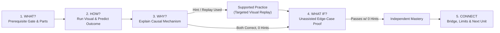

# Understanding App: Core Engine & Reconciled MVP Specification
**Status:** Committed Baseline (v2.0 — Dual-Experience Inductive Discovery + Apple-Minimalist UX)  
**Scope:** Universal, Topic-Agnostic Core Engine + Dead-Simple MVP (Ready for Project Scaffolding)

---

## 1. Core Thesis & Signature Experience ("Experience First, Name Last")
While tools like Perplexity produce static summary posters and NotebookLM generates 20 static illustrated slides (often diluted by irrelevant web-search fluff), the Understanding App makes complex concepts effortless to grasp through **Dual-Experience Inductive Discovery**:

1. **Two Unrelated Micro-Experiences (Zero Verbosity, No Title Spoiler):**
   * For each concept (`Mystery A`, `Mystery B`, `Mystery C`), the learner is given **two dead-simple, 8-second interactive micro-experiences from completely unrelated worlds** (e.g., *Kitchen Ingredients* + *Commute Routes*).
2. **The Pattern-Alignment Challenge:**
   * Because the two experiences look unrelated on the surface, the learner's brain automatically strips away surface details when asked: ***"One is X. One is Y. What same move did you make in both?"***
3. **The Earned Reveal (*"That's [Concept]."*):**
   * Only *after* the learner extracts the shared underlying mechanism does the engine reveal the concept name (**"That's Thinking."** / **"That's Learning."** / **"That's Understanding."**) and unlock its clean visual model.
4. **The Unified Loop & Unassisted *What-If* Proof:**
   * All discovered concepts connect into a single clean system loop, verified by an unassisted real-world diagnostic challenge.

---

## 2. The Universal Learning Spine: How the 4+1 Questions Drive the Engine
Every topic unit in the engine runs on the exact same 5-step instructional cycle mapped directly to the five core questions:



| Question | Cognitive Layer | Engine Runtime Step | How It Is Scored & Gated |
| :--- | :--- | :--- | :--- |
| **1. What?** | Facts & Building Blocks (aided by *Unlimited Memory* concrete labels/SEE) | **Step 1: Prerequisite Gate & Explore** | Before running the main visual, the learner must identify the immediate prerequisite parts. If they struggle, the engine teaches the prerequisite first. |
| **2. How?** | The Process in Motion | **Step 2: Run Visual & Rubric Check A (Prediction)** | Learner watches the verified object animate step-by-step and predicts the concrete output (e.g., count, direction, flow path). |
| **3. Why?** | Causal Mechanism & Termination | **Step 3: Rubric Check B (Mechanism) & Targeted Replay** | Asked alongside *How*, but scored **separately**. Credits correct *How* predictions while isolating misconceptions in *Why* and replaying only the broken step. |
| **4. What if?** | Transfer & Boundary Conditions | **Step 4: Unassisted Mastery Proof & Spaced Review** | Gatekeeper of mastery: if hints or replays were used during *How/Why*, the learner must solve a fresh *What-if* variant or boundary case with **zero hints** to unlock mastery. |
| **5. Connect?** | Real-World Bridge & Analogy Limits | **Step 5: Bridge, Limits & Next Building Block** | Explicitly shows where the analogy breaks, bridges parts to the real diagram/formula/code, and unlocks the *What* gate of the next unit. |

---

## 3. Part A: The Lesson Compiler (Authoring & Verification Pipeline)
To prevent noisy AI outputs or misleading analogies from teaching false mental models, every unit is compiled and verified **before** learners interact with it.

### Rule 1: Define the Observable Objective & Split Rubric First
Before any cards or visuals are generated, each unit defines:
* **One Observable Ability:** Stated as a concrete behavior (e.g., *"Predict what happens to prices when money grows faster than goods, and explain why"* or *"Predict what a loop prints and explain why it stops"*).
* **Split Scoring Rubric:**
  * `check_a_prediction`: Criteria for earning credit on the predicted outcome (*How*).
  * `check_b_mechanism`: Criteria for earning credit on the causal rule or termination condition (*Why*).
  * `known_misconceptions`: Common false beliefs linked to specific visual replays.

### Rule 2: The 5-Part "Living Object" Spec
The AI never draws freehand lessons; it populates a structured JSON spec rendered by one universal engine:
1. `parts`: The interactive entities (e.g., Chambers/Valves, Tap/Tub/Drain, Code/List items).
2. `connections`: What flows into or affects what.
3. `dials`: Variables the learner can adjust or break during *What-if* steps.
4. `rules`: Directional cause-and-effect and explicit **termination/boundary conditions**.
5. `outputs`: What the learner observes and measures.
6. `analogy_limits`: Explicit mappings of where the simplified model breaks compared to reality.

### Rule 3: The 5-Gate Simulation Accuracy Guardrails
> [!CAUTION]
> In an app that builds mental models, a flawed simulation is **fatal**: it actively wires a false causal rule into the learner's brain. No Topic Pack or Living Object Spec can be published without passing all five guardrails below.

| Guardrail Gate | What Fatal Mistake It Prevents | Hard Requirement in the Engine Schema |
| :--- | :--- | :--- |
| **Gate 1: Single Evolving System (No Metaphor Hopping)** | Switching analogies mid-topic (e.g., Desk → Stone Arch → GPS → Chart), which hides how parts connect across units. | A multi-unit path must declare **one root `system_model`**. Each unit zooms into or upgrades a layer of that same system rather than switching metaphors. |
| **Gate 2: Complete State-Transition Bridge** | Omitting the conversion step between states (e.g., showing Short-Term Memory and Long-Term Memory without the `STM ──► LTM` encoding & chunk-compression bridge). | Every multi-state object must explicitly define `source_state` → `bridge_condition` (what opens/blocks transfer) → `target_state` → `return_feedback_loop`. |
| **Gate 3: Zero "Phantom Controls" (Literal-Take Red Team)** | Adding UI controls or analogy parts that contradict reality (e.g., a "Stop button" on a finite `for` loop that makes learners say *"Then I press Stop"*). | Every dial, button, and stop condition must map 1-to-1 to a real mechanism in the verified sources. An adversarial review pass asks: *"If a beginner takes this visual 100% literally, what false rule will they infer?"* |
| **Gate 4: 4-Corner Boundary Truth Table** | Dials that look right at default values but teach nonsense when dragged to `0`, `min`, or `max`. | The spec must include a verified truth table for all 4 dial extremes (`Min/Min`, `Max/Min`, `Min/Max`, `Max/Max`) plus the empty/zero edge case before rendering. |
| **Gate 5: Runtime Misconception Canary** | A subtle visual flaw that slips past authoring review and confuses real learners in production. | If `>15%` of learners pass `Check A (Prediction)` but fail `Check B (Mechanism)` with the same misconception, the engine automatically flags `lesson_version` for review. |

---

## 4. Part B: The Learner Runtime & Grading State Machine

### 1. Correction-Friendly Grading
* **Praise what is right first:** Always acknowledge a passed `check_a_prediction` even when `check_b_mechanism` fails.
* **Semantic equivalence:** Accept everyday wording that captures the mechanism.
* **Single ambiguity follow-up:** If an explanation is incomplete or ambiguous, ask **one** targeted clarifying question before grading it as a misconception.

### 2. Strict Separation of `Supported Practice` vs. `Independent Mastery`
* Any attempt where the learner receives a clarifying follow-up, a hint, or a targeted visual replay is recorded as `Supported Practice`.
* To transition from `Supported Practice` to `Independent Mastery`, the learner must pass a **fresh unassisted test** (a new *What-if* dial setting, a different input list, or an empty/zero boundary case) with **zero hints**.
* Learners can pause and resume at any point in this loop without losing state.

### 3. Versioned Evidence Ledger (Core Data Schema)
Every attempt writes an immutable, versioned record so improvements to lessons or rubrics can be audited cleanly:

```json
{
  "attempt_id": "uuid",
  "learner_id": "uuid",
  "topic_id": "string",
  "objective_id": "string",
  "lesson_version": "1.0.0",
  "rubric_version": "1.0.0",
  "confidence_tap": "sure | unsure",
  "learner_response": "string",
  "followup_asked": "string | null",
  "check_a_prediction_pass": true,
  "check_b_mechanism_pass": false,
  "help_used": ["replay_boundary_step"],
  "mastery_state": "supported_practice | independent_mastery",
  "next_review_at": "ISO-8601 timestamp"
}
```

### 4. Spaced Transfer Schedule
* Mastered objectives enter the *Unlimited Memory* review schedule (`10 min → 1 hr → 1 day → 3 days → 7 days → 14 days...`), starting with a quick backwards review.
* Next-day and spaced reviews **always use a fresh example or *What-if* variant**, testing transfer rather than rote memorization of the original card.

### 5. End-of-Path Consolidation: The 3-Part "Unified Mastery Recap"
1. **Part 1 — The Backwards Chain Recall (Horsley's *Walk the Path Backwards* Rule)**
2. **Part 2 — Full-System Diagnostic Sandbox (Play Step 7: *Rebuild & Troubleshoot*)**
3. **Part 3 — The 4-Question Mastery Scorecard & 1-Line Personal Rule**

---

## 5. Dead-Simple MVP Scope & Pilot Evaluation
* **Audience & Content:** 1 beginner audience, 1 initial topic path consisting of **3 to 5 connected objectives**, built from reviewed source material.
* **Visuals:** 1 to 2 verified interactive templates (step-by-step animated flow + dial/boundary check) with human-verified boundary rules.
* **Session UX:** 5–10 minute card flow with PIC purpose setup, confidence tap, split-rubric feedback in ~3 seconds, targeted visual replay, unassisted *What-if* proof, Unified Mastery Recap, and pause/resume.

---

## 6. Validated Reference Path & Apple-Minimalist UI/UX Standards
1. **The "8-Second Micro-Toy" Rule (Zero Verbosity):** Each side-by-side experience must take under 8 seconds to play, use at most 1 tap/toggle or 1 clean dial, and contain under 15 words of copy.
2. **No Title Spoilers ("Mystery First, Label Last"):** Navigation pills start as `Mystery A / B / C` and transform into the concept name (`Thinking ✓`) only after the learner discovers the connection.
3. **Zero Developer Clutter on the Learner Surface:** All engine telemetry (split-rubric checks, versioned ledger, JSON specs, QA test personas) lives strictly in the backend / developer route—never on the learner screen.
4. **Combine Perplexity's Relevance with NotebookLM's Visual Metaphor Craft:** Every topic is filtered through `Step 2: Set Purpose and Level`, and every card uses clean, high-contrast visual metaphors.
